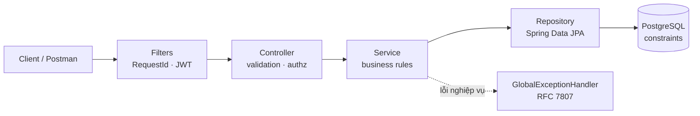

# Meeting Room Booking System

[](https://github.com/luongvantri91/meeting-room-system/actions/workflows/ci.yml)


Backend REST API đặt phòng họp cho công ty (~10 phòng, ~200 nhân viên).
Java 17 · Spring Boot 3 · PostgreSQL 16 · Flyway · JWT · Docker.

**Tính năng chính**

- Đăng ký / đăng nhập (JWT), phân quyền `USER` / `ADMIN`.
- Quản lý phòng: tạo, sửa, vô hiệu hóa, tìm phòng trống theo khung giờ và sức chứa.
- Đặt, sửa, hủy phòng; xem lịch (calendar) theo phòng, theo người đặt.

**Điểm nhấn kỹ thuật**

- **Không bao giờ đặt trùng phòng**: chống trùng lịch bằng exclusion constraint của PostgreSQL, không chỉ kiểm tra ở code.
  Có test 12 request đồng thời cùng đặt 1 phòng/1 khung giờ → đúng 1 thành công.
- **Đã kiểm chứng**: 63 test tự động (`mvn verify`) và 141 test case thủ công qua Postman (284 assertion, 0 lỗi), có bằng chứng kèm theo.
- Lỗi trả về theo chuẩn RFC 7807 kèm mã `code` ổn định; schema quản lý bằng Flyway.

**Mục lục**:
[Chạy hệ thống](#1-chạy-hệ-thống) ·
[Chạy test](#2-chạy-test-và-bằng-chứng-kiểm-thử) ·
[API](#3-api-apiv1) ·
[Thiết kế](#4-thiết-kế) ·
[Cấu trúc thư mục](#5-cấu-trúc-thư-mục) ·
[Giới hạn](#giới-hạn--hướng-mở-rộng)

## 1. Chạy hệ thống

**Cách 1 – Docker Compose** (yêu cầu Docker):

```bash
docker compose up --build
```

> Lưu ý: cách này chưa được chạy thử trọn vẹn. Trên GitHub Codespaces (Docker-in-Docker), app trong compose không kết nối được tới `db` do lỗi mạng của môi trường. Nếu gặp tình huống tương tự, dùng cách 2.

**Cách 2 – PostgreSQL bằng Docker, app bằng Maven** (đã kiểm chứng trên GitHub Codespaces, Java 17 + Maven):

```bash
docker run -d --name pg -p 5432:5432 \
  -e POSTGRES_DB=meetingroom -e POSTGRES_USER=meetingroom -e POSTGRES_PASSWORD=meetingroom \
  postgres:16-alpine

export JWT_SECRET=dev-only-secret-change-me-0123456789abcdef
export ADMIN_EMAIL=admin@company.local ADMIN_PASSWORD='ChangeMe123!'
mvn spring-boot:run -DskipTests
```

API chạy tại `http://localhost:8080`, health check: `GET /actuator/health` → `{"status":"UP"}`.
Có sẵn tài khoản admin (dùng cho dev): `admin@company.local` / `ChangeMe123!`.

Biến môi trường (xem [.env.example](.env.example); compose có giá trị mặc định cho dev):

| Biến | Ý nghĩa | Mặc định (dev) |
|------|---------|----------------|
| `DB_USER` / `DB_PASSWORD` | tài khoản PostgreSQL | `meetingroom` / `meetingroom` |
| `JWT_SECRET` | khóa ký JWT, **bắt buộc**, ≥ 32 ký tự | giá trị dev trong compose |
| `ADMIN_EMAIL` / `ADMIN_PASSWORD` | admin được tạo lúc khởi động | `admin@company.local` / `ChangeMe123!` |

> Production: bắt buộc đổi `JWT_SECRET`, `ADMIN_PASSWORD`, `DB_PASSWORD`.

## 2. Chạy test và bằng chứng kiểm thử

**Test tự động** – không cần Docker, test dùng PostgreSQL nhúng (zonky embedded-postgres):

```bash
mvn verify
```

63 test: unit (service, JWT), integration API (MockMvc + PostgreSQL thật), test ràng buộc DB và test đồng thời
(12 request cùng lúc đặt 1 phòng/1 khung giờ → đúng 1 thành công). CI: `.github/workflows/ci.yml`.

**Test thủ công với Postman** – 141 request chia 8 nhóm, mỗi request có script kiểm tra status, mã lỗi `code` và dữ liệu trả về:

| Nhóm | Request | Assertion đạt |
|------|--------:|--------------:|
| 1. Auth | 15 | 29/29 |
| 2. Rooms | 30 | 60/60 |
| 3. Bookings – tạo | 31 | 63/63 |
| 4. Bookings – xem / hủy | 9 | 18/18 |
| 5. Bookings – sửa | 23 | 48/48 |
| 6. Calendar | 17 | 34/34 |
| 7. Availability | 9 | 19/19 |
| 8. Vô hiệu hóa phòng | 7 | 13/13 |

- Collection và kế hoạch test: [docs/manual-testing/](docs/manual-testing/) ([postman-test-plan.md](docs/manual-testing/postman-test-plan.md)).
- Kết quả chạy (JSON), ảnh chụp và dữ liệu DB tương ứng: [docs/manual-testing/evidence/](docs/manual-testing/evidence/).
- Các trường hợp không thể kiểm tra bằng Postman (booking đã bắt đầu/kết thúc, đồng thời, token hết hạn) do `mvn verify` đảm nhiệm.

## 3. API (`/api/v1`)

Xác thực: header `Authorization: Bearer <token>`. Lỗi theo RFC 7807 (`application/problem+json`) kèm trường `code`.

| Method | Path | Quyền | Mô tả |
|--------|------|-------|-------|
| POST | `/auth/register` | public | đăng ký (role USER) |
| POST | `/auth/login` | public | đăng nhập, nhận JWT |
| POST | `/rooms` | ADMIN | tạo phòng |
| GET | `/rooms?active=&minCapacity=&page=&size=` | đăng nhập | danh sách phòng |
| GET | `/rooms/{id}` | đăng nhập | chi tiết phòng |
| PATCH | `/rooms/{id}` | ADMIN | sửa / vô hiệu hóa phòng |
| GET | `/rooms/available?from=&to=&minCapacity=` | đăng nhập | tìm phòng trống |
| POST | `/bookings` | đăng nhập | đặt phòng |
| GET | `/bookings?roomId=&from=&to=&mine=&includeCancelled=` | đăng nhập | lịch đặt phòng (calendar) |
| GET | `/bookings/{id}` | đăng nhập | chi tiết (xem được mọi booking) |
| POST | `/bookings/{id}/cancel` | chủ booking / ADMIN | hủy |
| PATCH | `/bookings/{id}` | chủ booking / ADMIN | sửa phòng, giờ, tiêu đề, số người |

Ví dụ:

```bash
# Đăng nhập admin
TOKEN=$(curl -s localhost:8080/api/v1/auth/login -H 'Content-Type: application/json' \
  -d '{"email":"admin@company.local","password":"ChangeMe123!"}' | jq -r .accessToken)

# Tạo phòng
curl -X POST localhost:8080/api/v1/rooms -H "Authorization: Bearer $TOKEN" -H 'Content-Type: application/json' \
  -d '{"name":"Phòng A","capacity":10,"location":"Tầng 2"}'

# Đặt phòng (thời gian ISO-8601, UTC)
curl -X POST localhost:8080/api/v1/bookings -H "Authorization: Bearer $TOKEN" -H 'Content-Type: application/json' \
  -d '{"roomId":1,"title":"Sprint planning","attendees":6,"startTime":"2030-01-10T02:00:00Z","endTime":"2030-01-10T03:00:00Z"}'

# Tìm phòng trống
curl "localhost:8080/api/v1/rooms/available?from=2030-01-10T02:00:00Z&to=2030-01-10T03:00:00Z&minCapacity=5" \
  -H "Authorization: Bearer $TOKEN"
```

Mã lỗi: `400` dữ liệu/khoảng thời gian sai · `401/403` chưa đăng nhập/không đủ quyền · `404` không tìm thấy ·
`409` xung đột (trùng lịch, trùng tên/email, booking đã bắt đầu/đã hủy/đã kết thúc không sửa được, phòng còn booking sắp tới) ·
`422` vi phạm nghiệp vụ (phòng ngừng hoạt động, vượt sức chứa, đặt vào quá khứ, thời lượng ngoài 15 phút–8 giờ).

## 4. Thiết kế

Modular monolith, phân tầng theo từng tính năng:



Tài liệu chi tiết:
[yêu cầu](docs/01-requirements.md) · [kiến trúc tổng quan](docs/02-high-level-architecture.md) · [thiết kế hệ thống](docs/03-system-design.md).

### Quyết định kỹ thuật

- **Chống trùng lịch ở tầng DB**: constraint `EXCLUDE USING gist (room_id WITH =, tstzrange(start,end,'[)') WITH &&) WHERE status='CONFIRMED'`.
  Kiểm tra ở service chỉ để trả lỗi thân thiện; DB là chốt chặn cuối nên an toàn khi nhiều request đồng thời và nhiều instance.
- **Khoảng nửa mở `[start, end)`**: booking 9–10h và 10–11h không xung đột.
- **Thời gian**: lưu `timestamptz`, truyền ISO-8601 UTC; `Clock` được inject để test được.
- **JWT stateless + BCrypt**, phân quyền USER/ADMIN bằng `@PreAuthorize`; secret không có giá trị mặc định trong code.
- **Flyway** quản lý schema; Hibernate chỉ validate.
- **Hủy mềm** (status `CANCELLED`) để giữ lịch sử; hủy lặp lại là idempotent.
- **Vận hành**: `X-Request-Id` + MDC logging, graceful shutdown, không lộ stack trace, chỉ mở health của actuator.

### Giả định & phạm vi

- Một công ty / một múi giờ hiển thị phía client; API làm việc với UTC.
- Đăng ký tự do tạo USER; chỉ ADMIN (seed từ env) quản lý phòng.
- Ngoài phạm vi: booking định kỳ, thông báo.

## 5. Cấu trúc thư mục

```
src/main/java/com/company/meetingroom/
├── auth/      đăng ký, đăng nhập, JWT, SecurityConfig, user
├── room/      Controller · Service · Repository · DTO của phòng
├── booking/   Controller · Service · Repository · DTO của booking
└── common/    xử lý lỗi (RFC 7807), RequestIdFilter, cấu hình chung
src/main/resources/db/migration/   Flyway (V1__init_schema.sql)
src/test/                          63 test tự động
docs/                              yêu cầu, kiến trúc, thiết kế, bằng chứng test thủ công
```

## Giới hạn & hướng mở rộng

Giới hạn đã biết:

- `PATCH /rooms/{id}` cho phép giảm `capacity` xuống dưới số người của các booking sắp tới.
- `docker compose up` chưa được kiểm chứng trên máy sạch (xem mục 1); các test và lần chạy thủ công đều dùng PostgreSQL nhúng hoặc PostgreSQL chạy riêng.

Hướng mở rộng: refresh token, booking định kỳ, thông báo email, rate limiting, OpenAPI/Swagger, metrics (Prometheus).
