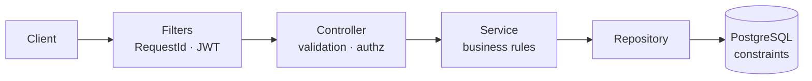

# Meeting Room Booking System

[](https://github.com/luongvantri91/meeting-room-system/actions/workflows/ci.yml)


Backend REST API đặt phòng họp cho công ty (~10 phòng, ~200 nhân viên).
Điểm nhấn: **không bao giờ đặt trùng phòng**, kể cả khi nhiều request đến cùng lúc.

## 📌 Tính năng chính

- Đăng ký / đăng nhập bằng JWT, phân quyền `USER` / `ADMIN`.
- Quản lý phòng: tạo, sửa, vô hiệu hóa; tìm phòng trống theo khung giờ và sức chứa.
- Đặt, sửa, hủy phòng; xem lịch (calendar) theo phòng hoặc theo người đặt.
- Lỗi trả về chuẩn RFC 7807 kèm mã `code` ổn định.

## 🛠️ Công nghệ sử dụng

| Thành phần | Công nghệ |
|------------|-----------|
| Ngôn ngữ / framework | Java 17, Spring Boot 3 (Web, Data JPA, Security, Validation, Actuator) |
| Cơ sở dữ liệu | PostgreSQL 16, Flyway (migration) |
| Bảo mật | JWT (jjwt), BCrypt |
| Test | JUnit 5, MockMvc, embedded PostgreSQL (zonky), Postman |
| Đóng gói / CI | Docker, Docker Compose, GitHub Actions |

## 🚀 Cài đặt & Chạy thử

**Cách 1 – Docker Compose**

```bash
docker compose up --build
```

**Cách 2 – PostgreSQL bằng Docker, app bằng Maven** (Java 17 + Maven)

```bash
docker run -d --name pg -p 5432:5432 \
  -e POSTGRES_DB=meetingroom -e POSTGRES_USER=meetingroom -e POSTGRES_PASSWORD=meetingroom \
  postgres:16-alpine

export JWT_SECRET=dev-only-secret-change-me-0123456789abcdef
export ADMIN_EMAIL=admin@company.local ADMIN_PASSWORD='ChangeMe123!'
mvn spring-boot:run -DskipTests
```

API chạy tại `http://localhost:8080` · health check `GET /actuator/health` · admin dev: `admin@company.local` / `ChangeMe123!`.
Biến môi trường xem [.env.example](.env.example); **production bắt buộc đổi** `JWT_SECRET`, `ADMIN_PASSWORD`, `DB_PASSWORD`.

**Thử nhanh**

```bash
TOKEN=$(curl -s localhost:8080/api/v1/auth/login -H 'Content-Type: application/json' \
  -d '{"email":"admin@company.local","password":"ChangeMe123!"}' | jq -r .accessToken)
curl localhost:8080/api/v1/rooms -H "Authorization: Bearer $TOKEN"
```

Danh sách endpoint, ví dụ và mã lỗi: **[Tài liệu API](docs/04-api-reference.md)**.

**Kiểm thử**

```bash
mvn verify   # không cần Docker, dùng PostgreSQL nhúng
```

| Loại | Quy mô | Kết quả |
|------|--------|---------|
| Tự động (unit, integration, ràng buộc DB, đồng thời) | 63 test | chạy trong CI |
| Thủ công bằng Postman | 141 request, 284 assertion | 0 lỗi – [bằng chứng](docs/manual-testing/evidence/) |

## 🏗️ Thiết kế



Modular monolith, chia package theo tính năng (`auth`, `room`, `booking`, `common`).
Chi tiết: [Yêu cầu](docs/01-requirements.md) · [Kiến trúc tổng quan](docs/02-high-level-architecture.md) ·
[Thiết kế hệ thống](docs/03-system-design.md) · [Cấu trúc thư mục](docs/05-project-structure.md).

### Quyết định kỹ thuật và lý do

| Quyết định | Lý do |
|------------|-------|
| Chống trùng lịch bằng `EXCLUDE USING gist` ở PostgreSQL | DB là chốt chặn cuối: an toàn khi nhiều request đồng thời và nhiều instance; kiểm tra ở service chỉ để trả lỗi thân thiện |
| Khoảng thời gian nửa mở `[start, end)` | Booking 9–10h và 10–11h không xung đột |
| Lưu `timestamptz`, API dùng ISO-8601 UTC | Tránh nhầm múi giờ; `Clock` được inject nên test được |
| JWT stateless + BCrypt, `@PreAuthorize` | Dễ scale ngang; secret không có giá trị mặc định trong code |
| Flyway quản lý schema, Hibernate chỉ validate | Schema có version, tái lập được trên mọi môi trường |
| Hủy mềm (`CANCELLED`) | Giữ lịch sử; hủy lặp lại là idempotent |
| `X-Request-Id`, graceful shutdown, ẩn stack trace | Truy vết và vận hành an toàn |

Giả định: một công ty, một múi giờ hiển thị phía client; đăng ký tự do tạo `USER`, chỉ `ADMIN` (seed từ env) quản lý phòng.

## Giới hạn & hướng mở rộng

**Hướng mở rộng**: refresh token, booking định kỳ, thông báo email, rate limiting, OpenAPI/Swagger, metrics (Prometheus).
