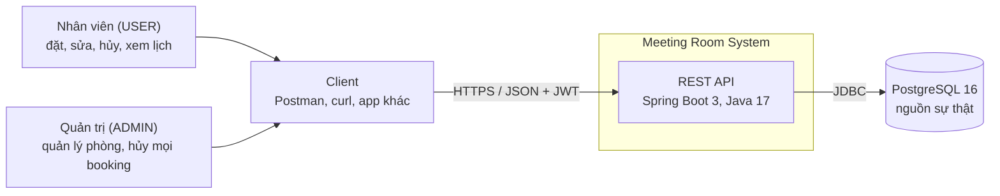
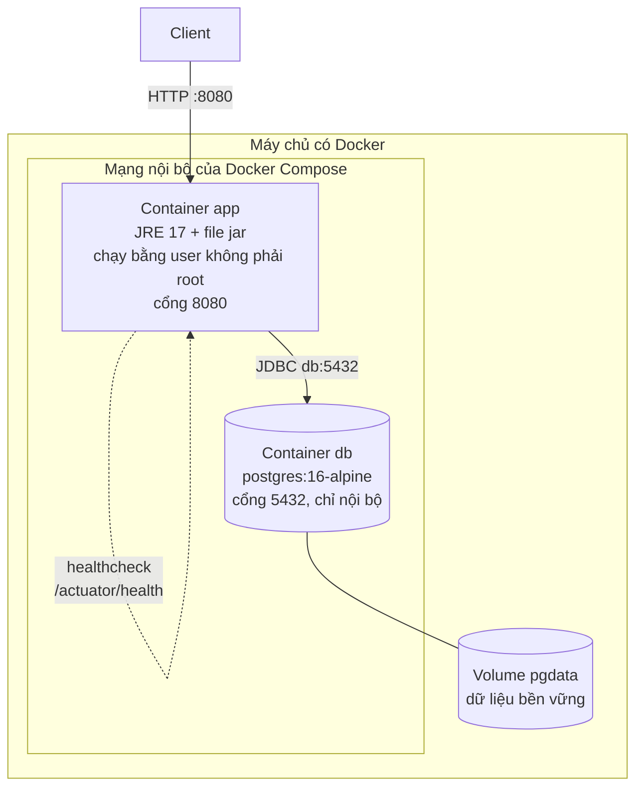
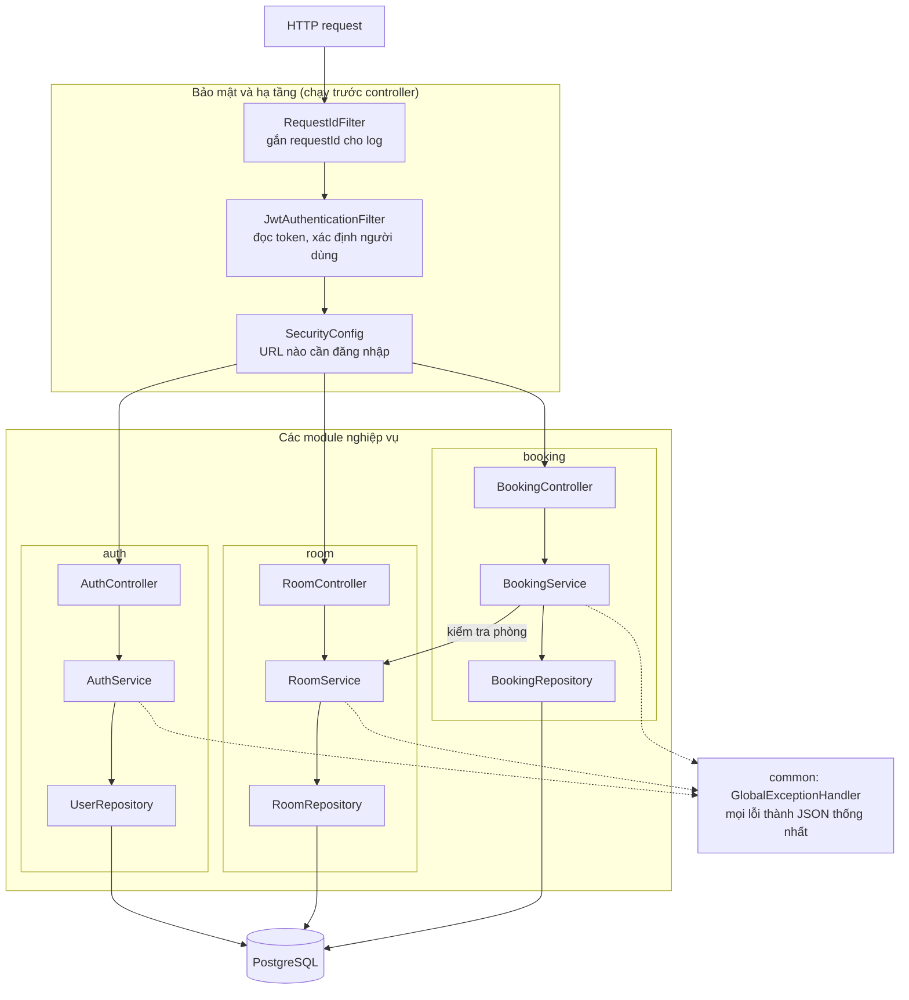
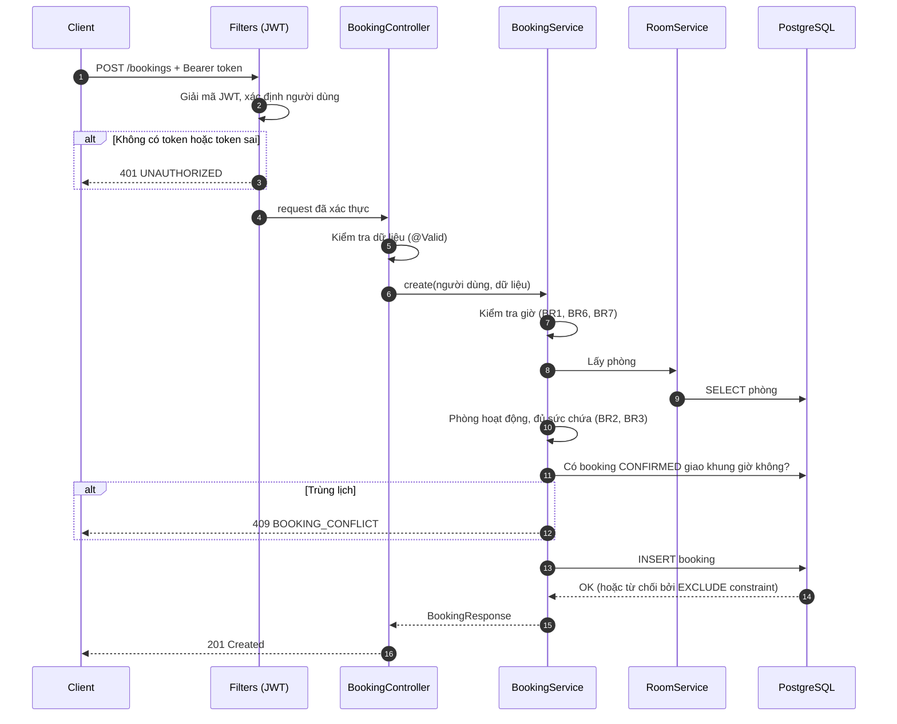
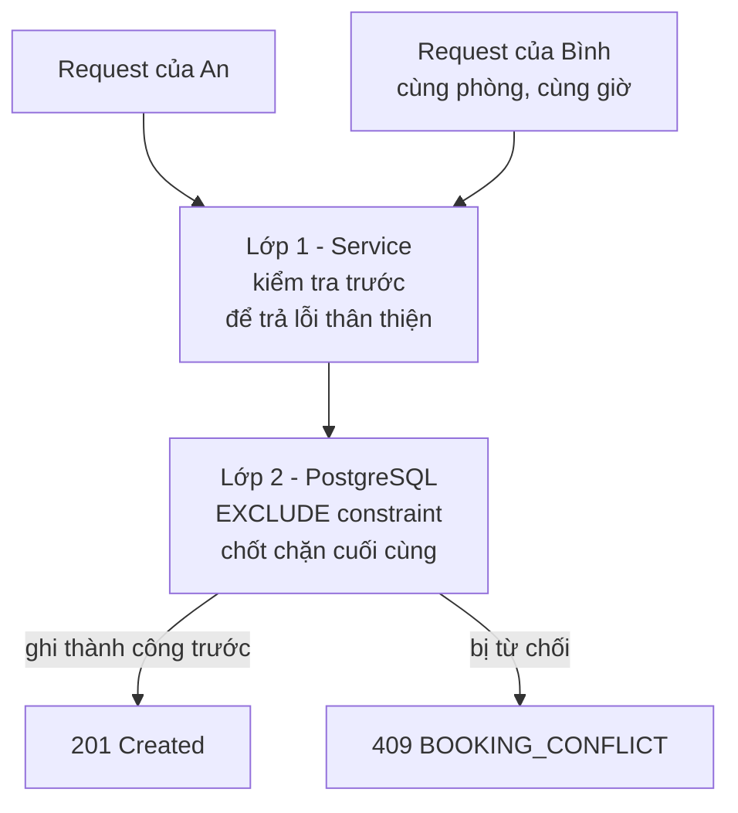
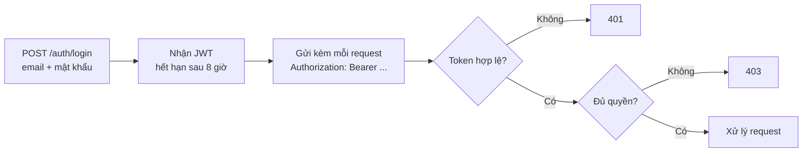

# 02 – Kiến trúc tổng quan (High-Level Architecture)

> Tài liệu này cho **cái nhìn tổng thể**: hệ thống gồm những khối nào và chúng nối với nhau ra sao.
> Chi tiết (bảng DB, API, mã lỗi, thứ tự kiểm tra) nằm ở [03-system-design.md](03-system-design.md).
> Yêu cầu nghiệp vụ (BRxx) nằm ở [01-requirements.md](01-requirements.md).
> Các sơ đồ dùng Mermaid, GitHub và VS Code (có extension Mermaid) hiển thị trực tiếp.

## 1. Hệ thống làm gì

Backend REST API giúp nhân viên đặt phòng họp và **không bao giờ có hai cuộc họp trùng giờ trong cùng một phòng**.
Quy mô: khoảng 10 phòng, 200 nhân viên. Không có giao diện web, chỉ có API.

## 2. Bức tranh tổng thể (System Context)

Ai dùng hệ thống và hệ thống phụ thuộc vào gì:

Hệ thống chỉ có **hai thành phần chạy**: API và database. Không có hàng đợi, cache hay dịch vụ ngoài.
Việc gửi email, SSO, frontend nằm ngoài phạm vi.

## 3. Triển khai (Deployment)

`docker compose up --build` dựng cả hệ thống:

| Cấu hình | Nơi đặt | Ghi chú |
|---|---|---|
| Kết nối DB | `DB_URL`, `DB_USER`, `DB_PASSWORD` | Mặc định trỏ `localhost:5432` khi chạy ngoài Docker |
| Khóa ký JWT | `JWT_SECRET` (≥ 32 ký tự) | Không commit secret thật; xem `.env.example` |
| Admin đầu tiên | `ADMIN_EMAIL`, `ADMIN_PASSWORD` | Tạo tự động khi khởi động nếu chưa có |
| Schema | Flyway chạy khi app khởi động | Bảng `flyway_schema_history` ghi phiên bản đã chạy |

Cổng 5432 của database không cần mở ra ngoài; chỉ app cần truy cập.

## 4. Các thành phần bên trong ứng dụng

Một ứng dụng duy nhất (**modular monolith**), chia package theo **module nghiệp vụ**.
Mỗi module có cùng các tầng, phân biệt bằng hậu tố tên file.

| Tầng | Việc của nó | Không được làm |
|---|---|---|
| **Controller** | Nhận HTTP, kiểm tra dữ liệu vào (`@Valid`), trả status code | Chứa quy tắc nghiệp vụ |
| **Service** | Quy tắc nghiệp vụ, giao dịch (`@Transactional`) | Biết chi tiết HTTP |
| **Repository** | Truy vấn database (Spring Data JPA) | Chứa quy tắc nghiệp vụ |
| **Entity / DTO** | Entity ánh xạ bảng; DTO là hình dạng JSON vào/ra | Lộ entity trực tiếp ra API |

Module `booking` gọi sang `RoomService` để lấy và kiểm tra phòng. Các module không truy cập repository của nhau.

## 5. Luồng một request tiêu biểu: đặt phòng

`POST /api/v1/bookings`

Người đặt luôn lấy từ **token**, không lấy từ dữ liệu client gửi lên (BR10).
Thứ tự kiểm tra ở service quyết định mã lỗi trả về: chi tiết ở mục 4.3 của [03-system-design.md](03-system-design.md).

## 6. Bài toán khó nhất: hai người đặt cùng lúc

Kiểm tra "có trùng không" rồi mới ghi là **chưa đủ**: hai request có thể cùng thấy "chưa trùng" rồi cùng ghi.
Vì vậy hệ thống có **hai lớp bảo vệ**:

- Ràng buộc `EXCLUDE USING gist` trên `(room_id, khoảng thời gian [start, end))` chỉ tính booking `CONFIRMED`.
- Do đó đúng **một** request thắng, các request còn lại nhận `409`. Có test tự động với 12 request đồng thời.
- Quy tắc nằm ở database nên vẫn đúng khi chạy nhiều instance của app hoặc có đường ghi khác.
- Khoảng nửa mở `[start, end)` cho phép họp nối tiếp (9–10h và 10–11h không xung đột).

## 7. Xác thực và phân quyền

| Cơ chế | Dùng cho |
|---|---|
| JWT stateless, không lưu session | 200 người dùng, dễ chạy nhiều instance |
| Mật khẩu băm BCrypt | Không lưu mật khẩu thô |
| `@PreAuthorize("hasRole('ADMIN')")` | API ghi phòng (tạo, sửa, vô hiệu hóa) |
| Kiểm tra trong service | Sửa, hủy booking: chỉ chủ booking hoặc ADMIN |

## 8. Các quyết định lớn và lý do

| Quyết định | Lý do | Đánh đổi |
|---|---|---|
| Modular monolith | Quy mô nhỏ, đơn giản để chạy và kiểm thử | Muốn tách service sau này phải đầu tư thêm |
| PostgreSQL là nguồn sự thật chống trùng lịch | Đúng cả khi đồng thời, không phụ thuộc lock ở app | Gắn chặt với PostgreSQL (cần extension `btree_gist`) |
| JWT stateless | Không cần session, mở rộng ngang dễ | Chưa có refresh token, khó thu hồi token trước hạn |
| Flyway quản lý schema | Schema có phiên bản, lặp lại được ở mọi môi trường | Phải viết migration mới thay vì sửa file cũ |
| Thời gian lưu UTC (`timestamptz`, `Instant`) | Tránh lỗi múi giờ | Client tự đổi sang giờ địa phương |
| Lỗi theo RFC 7807 kèm `code` | Client xử lý theo mã ổn định | Phải giữ bảng mã lỗi nhất quán |
| Test tích hợp trên PostgreSQL thật (nhúng) | Constraint của PostgreSQL phải test trên PostgreSQL | Chậm hơn dùng DB giả |

## 9. Yêu cầu phi chức năng

| Mối quan tâm | Cách đáp ứng |
|---|---|
| **Tính đúng khi đồng thời** | Exclusion constraint + test 12 request đồng thời |
| **Bảo mật** | JWT, BCrypt, phân quyền theo vai trò và theo chủ sở hữu, container chạy bằng user không phải root, không trả stack trace |
| **Quan sát được** | `requestId` trong mỗi dòng log, `/actuator/health` (liveness, readiness) |
| **Vận hành** | Cấu hình bằng biến môi trường, tắt dần êm (`graceful shutdown`), healthcheck trong Compose |
| **Khả năng kiểm thử** | `Clock` được inject để test các tình huống "bây giờ"; 63 test tự động chạy bằng `mvn verify` |
| **Khả năng mở rộng** | App không lưu trạng thái nên chạy được nhiều instance sau load balancer; cổ chai là một PostgreSQL |

## 10. Giới hạn đã biết

Chưa có: refresh token, booking định kỳ, thông báo email, giới hạn tần suất đăng nhập (rate limiting), OpenAPI/Swagger, metrics (Prometheus).
Một lỗ hổng nhỏ đã biết: `PATCH /rooms/{id}` cho hạ sức chứa thấp hơn số người của booking sắp tới (xem `docs/branches/00-handoff.md`).

## 11. Đọc tiếp

| Muốn biết | Đọc |
|---|---|
| Quy tắc nghiệp vụ, tiêu chí nghiệm thu | [01-requirements.md](01-requirements.md) |
| Bảng DB, API, mã lỗi, thứ tự kiểm tra | [03-system-design.md](03-system-design.md) |
| Cách chạy | [../README.md](../README.md) |
| Endpoint, ví dụ `curl`, mã lỗi | [04-api-reference.md](04-api-reference.md) |
